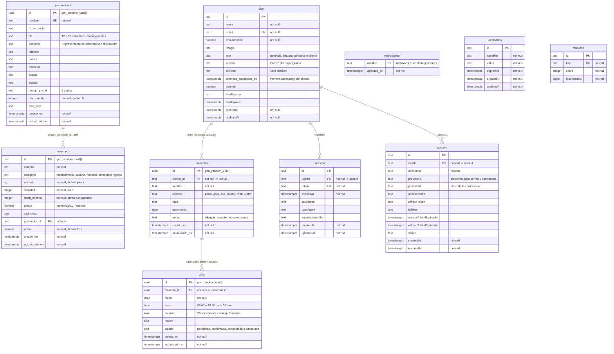

# Esquema de la base de datos — VetCareHub

Documentación visual del esquema PostgreSQL (Neon) de **VetCareHub** en formato Mermaid.  
Se renderiza directamente en GitHub y en la vista previa de Markdown de VS Code.

> Fuente equivalente para [dbdiagram.io](https://dbdiagram.io): [`db/esquema.dbml`](./esquema.dbml).  
> Las tablas del sistema se aplican con `pnpm db:migrar` (`db/migraciones/`) y las de autenticación con Better Auth.

## Diagrama entidad-relación

## Restricciones e índices destacados

- **`citas_horario_unico`**: índice único parcial en `(fecha, hora) WHERE estado <> 'cancelada'`.
- **`citas_hora_check`**: `hora BETWEEN '09:00' AND '18:30'` en bloques de 30 minutos (`00` y `30`).
- **Índices de llaves foráneas**: `inventario_proveedor_idx`, `mascotas_cliente_idx`, `citas_mascota_idx`, `session.userId`, `account.userId` y `verification.identifier`.
